# Open Notebook DataBridge

**Agentic AI research over public data, with human approval and verifiable database execution through MCP.**

Open Notebook DataBridge extends [Open Notebook](https://github.com/lfnovo/open-notebook) with a bounded research agent that turns notebook questions into SQL proposals and evidence-backed answers. Users discover and import public data, review the agent's proposed query, and approve execution through the **Model Context Protocol (MCP)**. Immutable DuckDB datasets and recorded query evidence make the results traceable. The application retains the original notebook, document, notes, search, transformation, and podcast features.

This is the [DataBridge fork](https://github.com/BFODonnell/open-notebook). The setup and features below describe this fork; the original project and its contributors are credited at the end.

[Live demo and evidence](docs/databridge/THREE_SOURCE_LIVE_DEMO.md) · [Deployment](deployment/databridge/README.md) · [Documentation](docs/index.md) · [Changelog](CHANGELOG.md)

## What DataBridge adds

- **Open Data Explorer:** search Data.gov, inspect publisher metadata and reuse rights, validate a resource, preview its schema and sample rows, and import it into a selected notebook.
- **Download discovery:** find supported files on bounded publisher landing pages, with explicit file and worksheet selection. Import paths support CSV, flat JSON/JSON Lines, Parquet, supported XLSX, and bounded single-file ZIP archives.
- **Immutable datasets:** publish versioned DuckDB datasets with source URLs, retrieval details, checksums, schema mappings, and processing history. Schema documentation is attached to the same notebook.
- **Agentic notebook research:** the research agent interprets a question against available dataset schemas, proposes SQL, and synthesizes an answer from returned evidence. Inspect the selected version and canonical SQL, then explicitly approve MCP execution. Answers include verified result cells, a result table, and query provenance; supported annual aggregations can also produce a trend chart.
- **MCP database integrations:** the deployment includes DBHub, Google's MCP Toolbox for Databases, and an isolated DuckDB broker. These provide a foundation for relational, cloud, and analytical database access, with explicit connection approval and notebook scopes. See [database coverage and verification status](#mcp-servers-and-database-coverage).
- **A three-source comparison:** select official Census population and NOAA Boston Logan observations alongside FTA NTD Service data. Review the transformation contract and SQL before creating an annual analytical dataset.
- **Visible processing and safe retries:** confirmation names the destination, and accepted jobs show progress or actionable errors. Retrying the same selected file and content in the same notebook reuses the existing import.
- **Model gateway and usage accounting:** optional LiteLLM routing provides model configuration, usage records, and budget controls. Existing direct providers remain available; gateway accounting covers gateway-routed calls.

Public accessibility alone does not establish unrestricted reuse. Missing, conflicting, or restrictive rights remain blocked. Download diagnostics distinguish host policy, publisher denial, timeouts, redirects, formats, and resource limits.

## Agentic AI and MCP

The agentic workflow is **plan → review → approve → execute through MCP → synthesize and verify**. The model proposes the analytical action and interprets its results; the application enforces authorization, SQL policy, execution limits, and evidence checks. Human approval is an explicit step in the agent workflow.

| Stage | Responsibility |
| --- | --- |
| Discover and import | The user searches Data.gov and selects resources. Application services check rights, resolve supported downloads, validate data, and publish immutable versions. |
| Plan | The research agent receives the notebook question and available dataset context, then proposes a dataset and SQL for the supported analysis. |
| Review and approve | The application validates and canonicalizes the query. The user reviews its dataset, version, and SQL and explicitly approves execution. |
| Execute with MCP | The application invokes the scoped database tool through MCP, enforcing the approved query and recording result and provenance evidence. |
| Synthesize and verify | The agent drafts an answer from the returned evidence. Application checks validate cited result cells and supported document quotes before displaying the answer. |

**MCP provides the database tool boundary for the agentic workflow.** It connects approved research actions to configured database services, including the immutable DuckDB broker used for imported public data. Notebook scope, approved capabilities, and recorded query evidence connect each answer to the data actually queried.

Data.gov discovery currently uses the catalog API directly and remains a guided user workflow. The agent operates on datasets available to the notebook; autonomous catalog search, dataset acquisition, and open-ended retry loops are outside the current implementation. The three-source preparation workflow uses a fixed, reviewed transformation contract. Its resulting dataset becomes available to the research agent for questions.

## MCP servers and database coverage

DataBridge includes **three MCP server integrations** connecting its agentic research and database controls to data tools. DBHub and Toolbox bring broad upstream database connector ecosystems; the DuckDB broker serves immutable datasets imported into notebooks.

| MCP integration | Database coverage | Current DataBridge verification |
| --- | --- | --- |
| **DBHub 1.5.0** | PostgreSQL, SQL Server, MySQL, MariaDB, SQLite, and Oracle | PostgreSQL is enabled and integration tested through the application. Other engines remain targets for separate certification and are blocked by the current DBHub execution policy. |
| **Google MCP Toolbox for Databases 1.15.0** | Connectors include AlloyDB, BigQuery, Cloud SQL, Spanner, Firestore, PostgreSQL, MySQL, SQL Server, Oracle, MongoDB, Redis, Elasticsearch, Neo4j, ClickHouse, Snowflake, and more | Reviewed, fixed PostgreSQL tools are integration tested through the application. Additional connectors require operator configuration, capability approval, and engine-specific validation. |
| **Isolated DuckDB MCP broker** | Local, versioned DuckDB datasets, including imported public data and reviewed analytical datasets | Integration tested and exercised in the live browser workflow: imports, schema inspection, approved SQL, verified results, and provenance. |

The connector lists above describe the pinned upstream servers' capabilities, as documented by [DBHub](https://github.com/bytebase/dbhub/blob/v1.5.0/README.md) and [MCP Toolbox](https://github.com/googleapis/mcp-toolbox/blob/v1.15.0/README.md). They are distinct from the application paths we have validated. Earlier SQLite transport experiments are recorded separately and do not establish current application support for SQLite. See the [MCP integration report](docs/databridge/PHASE_2_REPORT.md) and [live demo evidence](docs/databridge/THREE_SOURCE_LIVE_DEMO.md).

In **Settings → Database connections**, an administrator registers an approved MCP endpoint, sets notebook scope and table/column or curated-tool permissions, discovers capabilities, and explicitly approves them. Users can inspect schemas and review supported queries or prepared-tool calls before execution. Database credentials stay in the operator's server configuration; the application stores encrypted MCP bearer credentials.

The [MCP deployment guide](deployment/databridge/mcp/README.md) explains DBHub configuration, Toolbox prepared tools, the DuckDB broker, and network access. Enabling another database requires an appropriate server configuration, restricted database credentials, and validation of that engine's permissions and behavior. DBHub engines beyond PostgreSQL also require extending the application's current execution policy.

## How it works

```mermaid
flowchart LR
    A[Data.gov or reviewed publisher selection] --> B[Rights checks and validated preview]
    B --> C[Background import worker]
    C --> D[Immutable DuckDB version and provenance]
    D --> E[Research agent proposes SQL from notebook context]
    E --> F[Human reviews SQL and explicitly approves]
    F --> G[Scoped MCP execution]
    G --> H[Agent synthesizes answer from query evidence]
    H --> I[Application verifies evidence and displays results]
```



The frontend uses Next.js and React; FastAPI coordinates notebook state in SurrealDB and background jobs. The isolated DuckDB broker reads published versions. LangGraph implements the research agent's planning and synthesis stages, and Esperanto provides model access, with LiteLLM and PostgreSQL providing the optional gateway and usage ledger. DBHub/PostgreSQL and curated Toolbox integrations are available through separately configured MCP connections.

Importing a dataset does not paste every row into document chat. The notebook receives schema and provenance documentation; database questions query the actual immutable table through the reviewed MCP path.

## Verified live demonstration

The November 22, 2026 run created a fresh notebook, imported all three real sources through the browser, approved a seven-query comparison, and asked the notebook research agent a substantive comparison question. The agent's generated SQL was reviewed and executed through MCP, and its answer was checked against returned evidence. Independent Python CSV calculations reproduced the results from downloads matching the imported SHA-256 hashes. Reload, application restart, and retry checks preserved results without duplicate imports.

| Source | Actual selection | Observed imported dimensions |
| --- | --- | --- |
| FTA National Transit Database | 2022–2025 Annual Data - Service (by Mode and Time Period), CSV asset `wwdp-t4re` | 51,716 rows × 69 columns |
| U.S. Census Bureau | Vintage 2025 state population estimates; July 1 estimates for the comparison years | 66 rows × 97 columns |
| NOAA NCEI | Global Summary of the Year, Boston Logan `USW00014739`, 2022–2025, TAVG and PRCP, metric units | 4 rows × 10 columns |
| Reviewed analytical dataset | Massachusetts transit and population with Boston Logan weather context | 4 rows × 15 columns |

These dimensions describe that run, not permanent assertions about changing publisher data. The [complete live report](docs/databridge/THREE_SOURCE_LIVE_DEMO.md) records exact URLs, SQL, versions, calculations, limitations, and reproduction steps. [Machine-readable evidence](docs/databridge/evidence/three_source_live.json) includes schemas and query results.

The comparison aggregates only NTD `Annual Total` rows before attaching one Census population estimate and one Boston Logan weather observation per year. It checks duplicate keys and retains missing values and quality flags. Per-resident ratios are withheld when transit values are missing or questionable.

This is descriptive context: agency reporting years, Census July 1 estimates, and weather calendar years differ. Boston Logan is not a statewide weather average, and agency headquarters do not define where all trips occurred. The comparison does not establish causality or a balanced agency panel.

## Run DataBridge

### Prerequisites

- Docker Desktop with Linux containers, or Docker Engine with Compose v2.
- Credentials and model access for the provider you configure.
- A personal `DATAGOV_API_KEY` for Data.gov discovery; automated access does not accept `DEMO_KEY`.
- `uv` for Python development and the live validation launcher. Native frontend development also needs Node.js/npm.

Clone this fork and work from its root:

```bash
git clone https://github.com/BFODonnell/open-notebook.git Open_Notebook_DataBridge
cd Open_Notebook_DataBridge
```

### Configure the application stack

DataBridge is enabled through layered Compose files. The base gateway file alone does not enable dataset imports or database chat.

| Layer | Compose file | Setup guide |
| --- | --- | --- |
| Application, database and model gateway | `compose.databridge.yml` | [Gateway and credentials](deployment/databridge/README.md) |
| Scoped database access and DuckDB broker | `compose.databridge-mcp.yml` | [MCP configuration](deployment/databridge/mcp/README.md) |
| Catalog discovery and imports | `compose.databridge-ingestion.yml` | [Open Data Explorer](deployment/databridge/ingestion/README.md) |
| Research agent: SQL planning and evidence-backed answers | `compose.databridge-research.yml` | [Conversational research](deployment/databridge/research/README.md) |

1. Copy `deployment/databridge/.env.example` to `.env.databridge`. Configure independent application, database, encryption, and gateway secrets using the gateway guide. Select a model your account can access and its provider endpoint.
2. Add the MCP administrator/broker tokens and reviewed DBHub/Toolbox configuration paths described in the MCP guide. The full overlay includes those services and requires their configuration; it is not a zero-configuration quick start. Store private connector files under `.databridge-private/` or outside the build context.
3. Add your personal `DATAGOV_API_KEY`. The default publisher host list includes the supported DOT, Census, and NOAA hosts; an explicit operator override replaces that list.
4. Once those settings are complete, build and start the full stack:

```bash
docker compose --env-file .env.databridge -f compose.databridge.yml -f compose.databridge-mcp.yml -f compose.databridge-ingestion.yml -f compose.databridge-research.yml up -d --build --wait --wait-timeout 180
```

The standard DataBridge stack serves the UI at **http://localhost:8502** and the API at **http://localhost:5055**. Sign in with the configured application password. `DATABRIDGE_UI_PORT` and `DATABRIDGE_API_PORT` change the host ports. The application container starts the frontend, API, and required worker; keep all three running.

The original `docker-compose.yml` remains available for the underlying Open Notebook application. It does not replace the DataBridge overlays, and an upstream prebuilt image does not include this fork's new implementation.

### Existing live demo environment

The separate live validation environment uses **http://localhost:18503** for the UI and port **15056** for the API. It has its own configuration and persistent volumes. After completing the image and credential setup in the [live launcher guide](scripts/databridge_live/README.md), manage it with:

```bash
uv run --no-sync python scripts/databridge_live/run.py up
uv run --no-sync python scripts/databridge_live/run.py stop
```

The launcher is a controlled validation environment, not the default installation path. Real notebook chat requires a configured live model. The launcher guide explains how to use an OpenRouter credential saved in the app; an unconfigured placeholder does not produce synthetic answers in place of a real provider.

### Use the explorer and research agent

1. Create a notebook and select it as the destination in **Open Data Explorer**.
2. Search Data.gov, inspect a dataset, choose a supported resource, and **Validate and preview**.
3. Click **Import**, confirm the destination, and wait for **Ready - database query verified**.
4. Open that notebook and ask the research agent a supported data question.
5. Review the agent's proposed dataset version and SQL, then **Approve and execute through MCP**.
6. Inspect the agent's answer alongside the verified result table, query evidence, and provenance.

For the three-source demo, also import the Census and NOAA selections, then use **Reviewed annual comparison** to choose all three source versions and approve the transformation. Follow the [demo walkthrough](docs/databridge/THREE_SOURCE_LIVE_DEMO.md#reproduce) for the exact selections and chat question.

## Credentials, privacy and persistence

Credentials entered under **Models** are encrypted in SurrealDB's `credential` table using the configured `OPEN_NOTEBOOK_ENCRYPTION_KEY`. Preserve that encryption key with your database backups.

The two gateway configuration paths differ:

- **Standard Compose setup:** the operator supplies the provider credential as `OPENAI_API_KEY` through the protected `.env.databridge` file. The endpoint and model determine which provider receives it.
- **App-stored OpenRouter setup used by the live demo:** `.env.databridge-live-validation` stores `DATABRIDGE_OPENROUTER_CREDENTIAL`, the credential record ID, and the encryption/service configuration. The launcher loads the encrypted provider key from SurrealDB and passes the decrypted value to LiteLLM's runtime environment as `OPENAI_API_KEY`. It does not copy that provider key into the environment file.

`OPENAI_API_KEY` is the gateway's variable name; in the OpenRouter setup its value is an OpenRouter credential. Docker administrators can inspect container runtime environments. Do not commit secret files or put provider keys in frontend variables.

The application and datasets are self-hosted. A configured cloud model receives the context and query evidence supplied to it; self-hosting does not make cloud-provider calls local. Back up notebook/checkpoint data, SurrealDB, published dataset versions, LiteLLM's database, and stable secret configuration together. Keep the development password-based service on a trusted network; it is not a hardened multi-tenant deployment.

## Current boundaries

- SQL is bounded and read-only, scoped to approved tables, columns, notebook, and immutable version. Safe scalar numeric conversion and conditional aggregation are supported. Arbitrary joins, subqueries, file/network functions, and writes are not enabled.
- The cross-source workflow is the explicit Massachusetts/Boston Logan contract for 2022–2025. It creates a reviewed analytical dataset; it is not a general geography-matching or cross-database join engine.
- The original 2023 FTA Operating Expenses and Agency Information landing/file endpoints returned publisher HTTP 403 in the live environment. Their explicit CC0 is recognized, but that external denial remains. Successful HTML/XLSX parsing tests do not establish live access to those endpoints.
- Public access alone never grants reuse rights. The conflicting NOAA Data.gov entry remains restricted; the supported NOAA selection uses independently reviewed publisher metadata and policy evidence.
- Imports retain download, parser, publication, and query limits. General authenticated downloads, arbitrary API endpoints, and unsupported formats require additional adapters.
- Gateway costs are estimates for routed usage, not a complete provider invoice. New DataBridge UI keys exist in all 14 locales; some non-English entries still contain English text.

## Development and verification

Install Python dependencies with `uv`, including the DataBridge extra:

```bash
uv sync --extra databridge
```

Follow the [development setup](docs/7-DEVELOPMENT/development-setup.md) for native services and environment configuration. Startup order is SurrealDB, API, background worker, then frontend. `make start-all` starts the base development services; gateway/MCP services and DataBridge flags still need their documented configuration.

Backend checks from the repository root:

```bash
uv run pytest tests/
uv run ruff check .
uv run ruff format --check .
uv run python -m mypy .
```

Frontend checks from `frontend/`:

```bash
npm ci
npm run lint
npm run test:coverage
npm run build
```

Offline suites use mocks and isolated fixtures where appropriate. Live verification separately exercises actual catalog/publisher downloads, browser imports, the application MCP path, live model planning, and independent calculations. Never run real catalog credentials through the synthetic publisher overlay.

The [live report](docs/databridge/THREE_SOURCE_LIVE_DEMO.md#tests-and-limits) records test outcomes and the Windows native OpenSSL limitation. Reproducible verification scripts are in [`scripts/databridge_live/`](scripts/databridge_live/); the independent verifier checks matching source bytes rather than hardcoding changing upstream row counts.

## Documentation and contributions

| Topic | Reference |
| --- | --- |
| Live three-source demo, exact sources and evidence | [Demo report](docs/databridge/THREE_SOURCE_LIVE_DEMO.md) |
| Live environment and encrypted OpenRouter credential setup | [Launcher guide](scripts/databridge_live/README.md) |
| Gateway, MCP, ingestion and research deployment | [Deployment entry point](deployment/databridge/README.md) |
| Application architecture and development | [Developer documentation](docs/7-DEVELOPMENT/index.md) |
| Notebook, source and provider features inherited from upstream | [Documentation index](docs/index.md) |
| Implementation decisions | [Decision records](docs/7-DEVELOPMENT/decisions/) |
| Recent changes | [Changelog](CHANGELOG.md) |

Use this fork's [issue tracker](https://github.com/BFODonnell/open-notebook/issues) for DataBridge-specific defects. Include reproduction steps and distinguish fixture results from live observations. Follow [AGENTS.md](AGENTS.md) and the [contribution guide](docs/7-DEVELOPMENT/contributing.md) when making changes.

## Upstream credit and license

Open Notebook DataBridge builds on **Open Notebook**, created by **Luis Novo** and its contributors. The original research notebook, provider integrations, and core application architecture come from [lfnovo/open-notebook](https://github.com/lfnovo/open-notebook).

This fork retains the [MIT license](LICENSE) and the original copyright notice. DataBridge adds the catalog-to-notebook import, agentic research with approved MCP execution, model gateway, and analytical comparison workflows described above.
