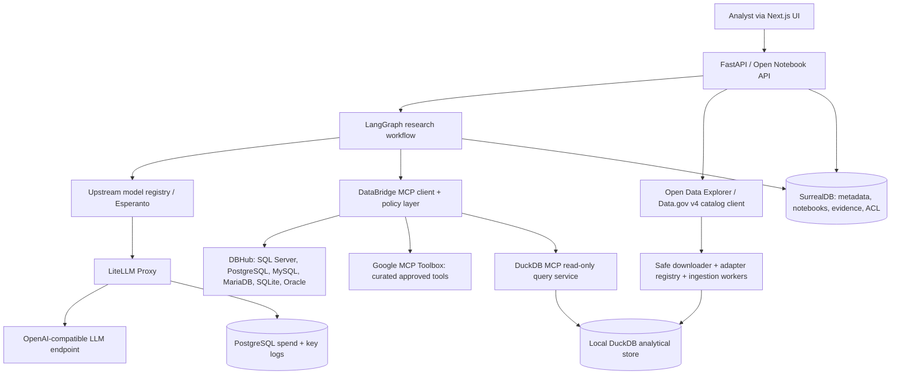

# 02 — Architecture and Integration Points

## Existing architecture (verify in current checkout)

Upstream Open Notebook currently documents: Next.js 16/React 19 frontend (`frontend/`), FastAPI (`api/`), domain objects in `open_notebook/domain/`, LangGraph workflows in `open_notebook/graphs/`, SurrealDB v2, and queued jobs in `commands/`. Open Notebook models are supplied through its **Esperanto** abstraction and a credential/model registry; do not replace it casually. Docker may run UI/API/worker under supervisord in one image, plus SurrealDB separately. Chat checkpoint persistence has an independent SQLite file. See `docs/14_REFERENCES.md`.

## Proposed logical components



**Avoid moving entire relational tables or imported files into the LLM context.** Embed/selectively index schema descriptions and documentation, not high-volume raw rows.

## Vertical integration slice

1. Search Data.gov through a typed FastAPI endpoint; API key stays backend.
2. User selects a resource and sees a classification. Clicking Import submits a background job via the **existing upstream worker framework**.
3. Worker validates URL + access policy; streams downloads to bounded quarantine; detects format; parses and profiles; stages DuckDB writes; publishes a dataset version on successful commit.
4. Worker writes metadata and a source reference into existing Open Notebook records; creates descriptive, searchable material for the notebook without copying all rows.
5. MCP client registry exposes the approved read-only local dataset query capability in the **same active notebook chat**.
6. LangGraph plans SQL and source retrieval, invokes policy checks, obtains approval when required, executes bounded query, verifies calculations, and saves evidence.
7. LLM traffic goes through registered OpenAI-compatible LiteLLM Proxy; monitoring reads permitted spend metadata from LiteLLM's PostgreSQL-backed endpoint.

## Proposed code placement (do not assume these paths already exist)

```text
open_notebook/databridge/
    catalog/datagov_v4.py
    ingestion/{manager,adapters,security,duckdb_store}.py
    mcp/{registry,client,adapters,sql_policy}.py
    evidence/{models,store,verifier}.py
    llm/{bootstrap,usage}.py
open_notebook/graphs/databridge_research.py
open_notebook/domain/databridge_*.py
api/routers/{databridge_catalog,databridge_imports,databridge_connections,databridge_usage}.py
commands/databridge_import.py
frontend/src/{components/databridge,lib/api/databridge*,lib/hooks/databridge*}/
```

Use real upstream conventions for Surreal migrations, Pydantic models, commands and frontend hooks; avoid creating a standalone FastAPI app.

## Key architectural concern: DuckDB concurrency

DuckDB normally allows one writer process or multiple read-only processes; an independently running MCP reader can lock a DB against ingestion writes. Do **not** simply mount one writable `.duckdb` file into an ingestion container and a long-lived read-only MCP service and assume concurrent access works. Make this a **P0 design spike**. Preferred paths, evaluated in order:

1. Coordinate import and query service so the read-only MCP connection can safely close and reopen around controlled writes; enforce a bounded query drain and version publication. Works for a small demo if proven.
2. Build each dataset/version in a **staged separate DuckDB file**, then publish an immutable version; MCP readers open the new file read-only by version. Avoid direct arbitrary database-switch tools; expose approved dataset-version aliases through a broker/registry.
3. If unavoidable, move writer/read concurrency behind one trusted process or choose an alternative service approach, while preserving DuckDB as default storage. Record decision and tests.

MVP preference: **immutable, versioned dataset files** with an application-managed read-only query broker, if the selected MCP server can be securely provisioned per version. Otherwise use a coordinated single shared DuckDB service with tested lease/lock logic. Never expose unrestricted `switch_database_connection` to agents.

## Deployment

Target a Docker Compose stack with: Open Notebook app (UI+API+worker as upstream), SurrealDB, LiteLLM Proxy, dedicated PostgreSQL for LiteLLM, DBHub, local DuckDB MCP, Google MCP Toolbox, and named persistent DuckDB/import volumes. Add sample data containers only under a `demo` profile. Keep most ports on internal networks, expose only approved UI endpoint, and use actual pinned image versions/digests.

## Observability and status

Provide `/api/databridge/health` as an aggregated component-status view (not an unrestricted diagnostic leak), plus structured logs with correlation IDs for import_job, query_run, notebook, model request, and MCP call. Secret-bearing values and raw restricted query results must not be logged.
